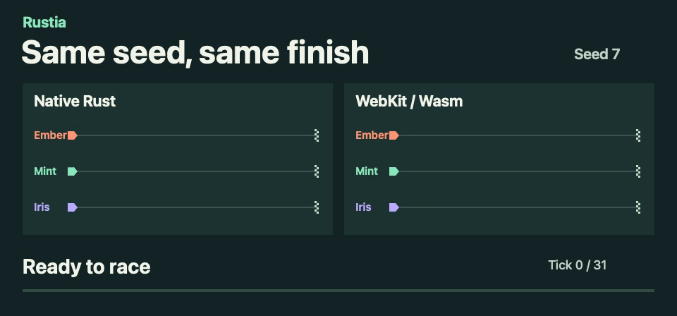
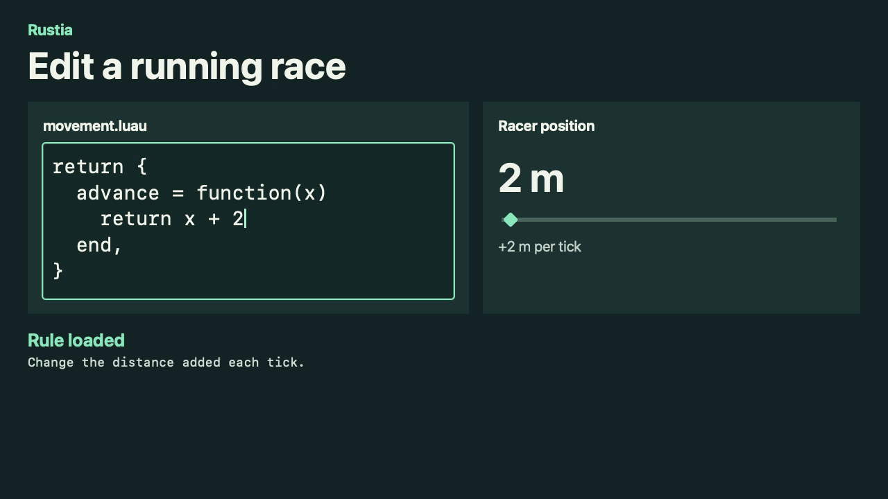

# Rustia

Rustia is a pure-Rust interpreter for standalone Luau. Use it to script a Rust
application or replay a simulation on native and WebAssembly targets. The source
is public for experimental use.

**Deterministic replay.** The same Luau script runs natively on the left and as
WebAssembly in a browser on the right. With the same random seed, each racer
takes the same steps on both tracks. Change the seed and the winner changes
from Mint to Iris. [Record the race](https://github.com/slowchop/rustia/blob/main/demos/web-live/README.md#record-the-race).



## Try it

Install this interpreter from Git until its first crates.io release. Use the pinned revision below.
With Rust 1.95 or newer, run `cargo new hello-rustia`, then `cd hello-rustia`.
Add this line under `[dependencies]` in `Cargo.toml`.

```toml
rustia = { git = "https://github.com/slowchop/rustia", rev = "bfe174e1948259be57807ca10aee3b4ff55f9f56" }
```

Rust gives Luau a score and a function called `double`. Put this in
`src/main.rs` and run `cargo run`.

```rust
use rustia::Rustia;

fn main() -> rustia::Result<()> {
    let mut vm = Rustia::builder().build()?;
    vm.insert_global("base_score", 21)?;
    vm.add_fn("double", |value: f64| value * 2.0)?;

    let score: f64 = vm
        .load("return double(base_score)")
        .source_name("score.luau")
        .eval()?;

    println!("The score is {score}");
    assert_eq!(score, 42.0);
    Ok(())
}
```

The program prints `The score is 42`. Use `eval` to get a value back from Luau,
or `exec` when you just want to run the script.

## Call script functions from Rust

Replace `src/main.rs` with this example and run `cargo run` again. This time
Luau defines `greet`, and Rust calls it with `"Ada"`. The program prints `Hello, Ada`.

```rust
use rustia::Rustia;

fn main() -> rustia::Result<()> {
    let mut vm = Rustia::builder().build()?;
    let exports = vm
        .load("return { greet = function(name) return 'Hello, ' .. name end }")
        .source_name("greetings.luau")
        .install()?;

    let greet = exports.function(&mut vm, "greet")?;
    let message: String = greet.call(&mut vm, ("Ada",))?;
    println!("{message}");
    assert_eq!(message, "Hello, Ada");
    Ok(())
}
```

To reload a script, keep its functions until the edited version installs
successfully. If the edit fails, your app can keep calling the old functions.
[Hot reload example](https://github.com/slowchop/rustia/blob/main/crates/rustia/examples/hot_reload.rs)

**Hot reload in the browser.** The racer keeps moving when an edit introduces a syntax
error. Changing the rule from `+ 2` to `+ 4` doubles its speed on the next tick. [Run the demo](https://github.com/slowchop/rustia/blob/main/demos/web-live/README.md#edit-a-running-race).



## Choose an environment

Start with `Rustia::builder()`. It uses a fixed random seed and repeatable clocks.

- Use `RustiaBuilder::deterministic()` for simulations that need to replay the same way from the same inputs.
- Use `RustiaBuilder::live()` when a script needs the current time or a fresh random seed.

By default, scripts have no instruction or memory budget. To set one, call
`.fuel(100_000)` or `.memory_limit_bytes(2 * 1024 * 1024)` on the builder.
Fuel counts work done by the interpreter. The memory limit covers allocations
Rustia tracks for the script.

## Examples and API reference

From a checkout, run the embedding example or open the API reference in your browser.

```sh
git clone https://github.com/slowchop/rustia.git
cd rustia
cargo run --locked -p rustia --example embedding
cargo doc --locked -p rustia --no-deps --open
```

- [Read a Luau table into a Rust struct with Serde](https://github.com/slowchop/rustia/blob/main/crates/rustia/examples/embedding.rs)
- [Call methods on a Rust object from Luau](https://github.com/slowchop/rustia/blob/main/crates/rustia/examples/mutable_objects.rs)
- [Show the line that caused a script error](https://github.com/slowchop/rustia/blob/main/crates/rustia/examples/diagnostics.rs)
- [Run Rustia in a browser](https://github.com/slowchop/rustia/blob/main/demos/web-live/README.md)
- [Move an idle interpreter to another thread](https://github.com/slowchop/rustia/blob/main/design/75-embedded-api.md#transferable-application-facade-2026-11-17)

[Browse all Rust examples](https://github.com/slowchop/rustia/tree/main/crates/rustia/examples)

### Run Luau from the command line

From the same checkout, you can run a file or try one line of Luau.

```sh
cargo run --locked -p rustia-cli -- path/to/script.luau
cargo run --locked -p rustia-cli -- --eval "print(40 + 2)"
```

The second command prints `42`. For an interactive prompt, pass `--repl`.
Type `=40 + 2` to see the result and `:quit` to exit.

<a id="how-does-it-compare"></a>

<!-- rustia-luau-comparison -->

## Rustia and other Luau projects

### Lua and Luau

- **Lua provides** functions, tables for storing data, and coroutines that can pause and resume.
- **Luau adds** shortcuts like `score += 1`, `continue` in loops, and optional type annotations. Rustia runs annotated scripts without a static type check.

Rustia targets standalone Luau 0.709, including its vector and buffer libraries. Roblox services are outside that scope. [Tested language features](https://github.com/slowchop/rustia/blob/main/conformance/COVERAGE.md)

### What Rustia adds

- **Replay on desktop and in a browser.** In deterministic mode, the same script, seed, and inputs produce the same decisions. [Watch the native and Wasm race](https://github.com/slowchop/rustia#readme)
- **Keep running through a bad edit.** Try a new module while the app runs. If installation fails, Rustia restores the previous script state and your app can keep calling the old functions. [Hot reload example](https://github.com/slowchop/rustia/blob/main/crates/rustia/examples/hot_reload.rs)
- **Give each decision a budget.** Limit the work a script can do and the memory Rustia tracks for it. A script can queue changes for Rust and deliver them only when the call succeeds. [Runnable example](https://github.com/slowchop/rustia/blob/main/crates/rustia/examples/hardened_decision.rs)

### Compare Luau projects

All seven compile Luau to bytecode. ulua, mlua and Lune also offer a native JIT. For source-to-source transpilation or bundling, see [darklua](https://darklua.com/).

| Project | Desktop | Browser&nbsp;Wasm | Hot&nbsp;reload | Replay |
| --- | --- | --- | --- | --- |
| **Rustia** | ![Linux][rustia-linux]&nbsp;![macOS][rustia-macos]&nbsp;![Windows][rustia-windows]&nbsp;[\[1\]](#luau-note-1) | [Demo](https://github.com/slowchop/rustia/blob/main/demos/web-live/README.md) | Rollback | [✓&nbsp;Tested](#luau-note-1) |
| luaur | ![Linux][rustia-linux]&nbsp;![macOS][rustia-macos]&nbsp;![Windows][rustia-windows]&nbsp;[\[2\]](#luau-note-2) | [Playground](https://pjankiewicz.github.io/luaur/) | Run&nbsp;code | — |
| ulua | ![Linux][rustia-linux]&nbsp;![macOS][rustia-macos]&nbsp;![Windows][rustia-windows]&nbsp;[\[3\]](#luau-note-3) | [Playground](https://webc-site.github.io/ulua/) | Run&nbsp;code | — |
| ruau | ![Linux][rustia-linux]&nbsp;[\[4\]](#luau-note-4) | — | Reload&nbsp;module | [◐&nbsp;Controls](#luau-note-4) |
| luau-rs/luau | ![Linux][rustia-linux]&nbsp;[\[5\]](#luau-note-5) | [CI&nbsp;tests](https://github.com/luau-rs/luau/blob/99cc8ce63190b7535a65752faa84ce620b4230c0/.github/workflows/browser.yml) | Run&nbsp;code | — |
| mlua | ![Linux][rustia-linux]&nbsp;![macOS][rustia-macos]&nbsp;![Windows][rustia-windows]&nbsp;[\[6\]](#luau-note-6) | [Build](https://github.com/mlua-rs/mlua/blob/3c0fd858825a4756e5e858356c3c70ab83e64dbe/.github/workflows/main.yml#L221-L259) | Replace&nbsp;module | — |
| Lune | ![Linux][rustia-linux]&nbsp;![macOS][rustia-macos]&nbsp;![Windows][rustia-windows]&nbsp;[\[7\]](#luau-note-7) | — | Load&nbsp;script | — |

**Desktop** shows platforms listed in CI, release builds or recorded runs. ![Linux][rustia-linux] Linux · ![macOS][rustia-macos] macOS · ![Windows][rustia-windows] Windows. Rustia also runs on ARM64 iOS and Android. [\[1\]](#luau-note-1)

**Replay** means the same script and inputs produce the same result across targets in a reproducible configuration. ✓ Tested means matching native and browser results. ◐ Controls means the host can fix the seeds and clock. A dash means the sources below did not establish that capability.

**Sources and details** · Checked 20 November 2026.

1. <a id="luau-note-1"></a>Rustia restores the previous script state when a module install fails. Its deterministic mode reproduces the native run in a browser. ARM64 mobile tests passed on a physical iPad and an Android 15 emulator, with a browser run in iPad Safari. [Compiler](https://github.com/slowchop/rustia/blob/main/crates/rustia-compiler/src/lib.rs) · [Hot reload](https://github.com/slowchop/rustia/blob/main/crates/rustia/examples/hot_reload.rs) · [Native/Wasm replay](https://github.com/slowchop/rustia/blob/main/demos/web-live/README.md#record-the-race) · [Desktop](https://github.com/slowchop/rustia/blob/main/design/96-browser-platform-acceptance.md) · [Mobile](https://github.com/slowchop/rustia/blob/main/design/96-browser-platform-acceptance.md#type-grammar-candidate-execution--2026-11-13) · [Safari](https://github.com/slowchop/rustia/blob/main/design/96-browser-platform-acceptance.md#physical-ipad-safari-execution--2026-11-14)
2. <a id="luau-note-2"></a>luaur 0.1.8 is a Rust port. It can run new code in the same VM. Native JIT execution is outside this version’s scope. [Project](https://github.com/pjankiewicz/luaur/tree/f0eac7f7cce691d0cdb0b93c3eef9d599f71d739) · [Code generation](https://github.com/pjankiewicz/luaur/blob/f0eac7f7cce691d0cdb0b93c3eef9d599f71d739/crates/luaur-code-gen/src/functions/compile_code_gen_context.rs) · [Desktop CI](https://github.com/pjankiewicz/luaur/blob/f0eac7f7cce691d0cdb0b93c3eef9d599f71d739/.github/workflows/ci.yml)
3. <a id="luau-note-3"></a>ulua 0.1.7 forks luaur and adds an opt-in native JIT. It can run new code in the same VM. [Project](https://github.com/webc-site/ulua/blob/975ebfe98327a968b0b5b2ac787795145bce0101/README.md) · [JIT](https://github.com/webc-site/ulua/blob/975ebfe98327a968b0b5b2ac787795145bce0101/README.md#jit-native-acceleration--switching) · [Desktop CI](https://github.com/webc-site/ulua/blob/975ebfe98327a968b0b5b2ac787795145bce0101/.github/workflows/ci.yml)
4. <a id="luau-note-4"></a>ruau 0.3.0 lets the host unload modules and fix the clock, hash seed and random seed. Its docs describe a Wasm clock. Cross-target replay and browser execution are unverified. [Project](https://github.com/cortesi/ruau/tree/aab5052e1a3d6ed91c3e8860f950ecfea972030d) · [Linux run](https://github.com/slowchop/rustia/blob/da1b8e546d4108d657d875b60ad28dffb354a974/bench/RESULTS.md) · [Wasm clock](https://github.com/cortesi/ruau/blob/aab5052e1a3d6ed91c3e8860f950ecfea972030d/crates/ruau-vm/src/limits.rs#L29-L77) · [Module API](https://github.com/cortesi/ruau/blob/aab5052e1a3d6ed91c3e8860f950ecfea972030d/crates/ruau-vm/src/lib.rs#L1522-L1602) · [Seed controls](https://github.com/cortesi/ruau/blob/aab5052e1a3d6ed91c3e8860f950ecfea972030d/crates/ruau-vm/src/limits.rs)
5. <a id="luau-note-5"></a>luau-rs/luau runs new chunks in the same VM and tests browser execution. Native code generation is in development. [Project](https://github.com/luau-rs/luau/blob/99cc8ce63190b7535a65752faa84ce620b4230c0/README.md) · [Embedding API](https://github.com/luau-rs/luau/blob/99cc8ce63190b7535a65752faa84ce620b4230c0/packages/luau/README.md) · [Browser CI](https://github.com/luau-rs/luau/blob/99cc8ce63190b7535a65752faa84ce620b4230c0/.github/workflows/browser.yml)
6. <a id="luau-note-6"></a>mlua binds Rust to upstream C++ Luau and also supports Lua. The host can replace a registered module. CI builds for Emscripten. Bare Wasm needs WASI imports and Wasm exceptions. [Project](https://github.com/mlua-rs/mlua/blob/3c0fd858825a4756e5e858356c3c70ab83e64dbe/README.md) · [JIT](https://luau.org/performance/) · [Emscripten](https://github.com/mlua-rs/mlua/blob/3c0fd858825a4756e5e858356c3c70ab83e64dbe/.github/workflows/main.yml#L221-L259) · [Bare Wasm](https://github.com/mlua-rs/mlua/blob/3c0fd858825a4756e5e858356c3c70ab83e64dbe/docs/wasm32.md) · [Module API](https://github.com/mlua-rs/mlua/blob/3c0fd858825a4756e5e858356c3c70ab83e64dbe/src/state.rs#L538-L560)
7. <a id="luau-note-7"></a>Lune 0.11.1 uses mlua. It can load an edited script or bundle its VM and bytecode into a standalone executable. [Project](https://github.com/lune-org/lune/tree/v0.11.1) · [Executable](https://github.com/lune-org/lune/blob/v0.11.1/crates/lune/src/standalone/mod.rs) · [Desktop releases](https://github.com/lune-org/lune/blob/v0.11.1/.github/workflows/release.yaml) · [Script loading](https://github.com/lune-org/lune/blob/v0.11.1/crates/lune-std-luau/src/lib.rs)

[rustia-linux]: https://github.com/slowchop/rustia/raw/6a212ab9742cb1b1c03b26bdd27c720eadcba492/demos/web-live/icons/linux.svg
[rustia-macos]: https://github.com/slowchop/rustia/raw/6a212ab9742cb1b1c03b26bdd27c720eadcba492/demos/web-live/icons/macos.svg
[rustia-windows]: https://github.com/slowchop/rustia/raw/6a212ab9742cb1b1c03b26bdd27c720eadcba492/demos/web-live/icons/windows.svg

<!-- /rustia-luau-comparison -->

Koto and Rhai each have their own scripting language. The timings below include both, along with Roto.

### Speed: a measured snapshot

Upstream Luau via mlua was faster than Rustia on all five workloads in this run.
The chart includes upstream C++ Luau in interpreter and JIT modes alongside the Rust implementations.


Each language has its own version of each workload. Roto uses a list for sparse
lookups and a regular function for the closure test. The timings cover scripts already running. The [full results](https://github.com/slowchop/rustia/blob/da1b8e546d4108d657d875b60ad28dffb354a974/bench/RESULTS.md)
also show how long each engine took to get started.

<details>
<summary>See times for Rustia, mlua + Luau, Koto, and Rhai</summary>

**Microseconds per work unit; lower is better.** These are best observed
steady-state interpreter times on Linux x86-64, measured by `ci-bench` on
2026-10-22 UTC at source commit `9b12a5a`. Compilation and first-call costs are separate.

<!-- rustia-benchmark-snapshot
{
  "commit": "9b12a5a8540f69fe7c0f6daebe467c795bb576c3",
  "target": "linux-x86_64",
  "start": 1792642181,
  "end": 1792642445,
  "engines": [
    "rustia",
    "mlua-luau",
    "koto",
    "rhai"
  ],
  "workloads": [
    "dense_tables",
    "sparse_tables",
    "closures_upvalues",
    "generic_iteration",
    "stdlib_math_table"
  ]
}
-->
| Work unit | Rustia | mlua + Luau | Koto | Rhai |
|---|---:|---:|---:|---:|
| Build, sum, and sort a 256-item array | 51.657 | 18.919 | 262.217 | 313.191 |
| Fill and read 128 hash entries | 87.555 | 22.485 | 146.082 | 348.085 |
| One closure call updating a captured value | 0.197 | 0.051 | 0.346 | 1.478 |
| Custom, keyed, and array iteration pass | 14.035 | 4.170 | 7.391 | 9.566 |
| Math library calls and buffered appends | 1.421 | 0.237 | 1.536 | 3.174 |

[Raw measurements](https://github.com/slowchop/rustia/blob/da1b8e546d4108d657d875b60ad28dffb354a974/bench/current-results.json) · [Benchmark limitations](https://github.com/slowchop/rustia/blob/da1b8e546d4108d657d875b60ad28dffb354a974/bench/CLAIMS.md)

</details>

## Project status and source access

Rustia’s API may change before its first supported release. See [which platforms have been tested](https://github.com/slowchop/rustia/blob/main/design/96-browser-platform-acceptance.md)
and [what’s left before release](https://github.com/slowchop/rustia/blob/main/design/90-release-readiness.md).

Anyone can read the [maintainer backlog](https://github.com/slowchop/rustia/issues) and pull requests.
Only repository collaborators can open issues or pull requests. See the
[contribution policy](https://github.com/slowchop/rustia/blob/main/CONTRIBUTING.md) and
[private reporting instructions](https://github.com/slowchop/rustia/security/policy).

## License

Licensed under either [Apache-2.0](LICENSE-APACHE) or [MIT](LICENSE-MIT), at your option.
