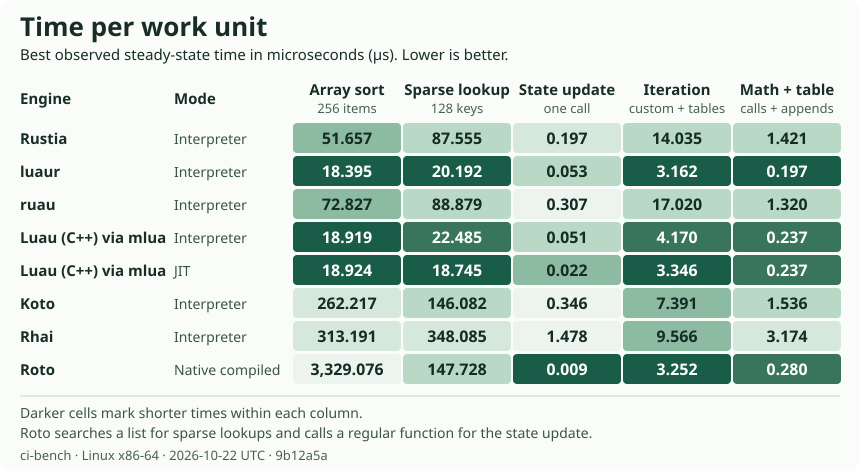

#  Rustia

<!-- project-copy: intro -->
Rustia is a pure-Rust interpreter for embedding standalone [Luau](https://luau.org/) in games and tools. Edit scripts without a rebuild and let players write mods.

Rustia grew out of a game by [Slowchop Studios](https://slowchop.com/) that needed to script character decisions and replay them on desktop and in a browser.
<!-- /project-copy: intro -->

**Version note.** [`0.1.0`](https://crates.io/crates/rustia/0.1.0) was an earlier
game-engine project I set aside. `0.2.0` is planned as the first release of this
Luau interpreter.

## Features

<!-- project-copy: features -->
<details>
<summary><strong>Hot reload</strong></summary>

Edit Luau without a rebuild. Your app keeps running and can carry state across edits, like the flowers’ positions in the garden. If a reload fails, Rustia can restore the previous script state. · [Try the garden](https://rustia.dev/)

</details>

<details>
<summary><strong>Deterministic execution</strong></summary>

Replay a run. In deterministic mode, the same script, starting state, seed, and ordered inputs produce matching results on native and WebAssembly. That helps reproduce bugs and keep lockstep multiplayer clients in sync. · [Deterministic builder](https://rustia.dev/docs/api/rustia/struct.RustiaBuilder.html#method.deterministic)

</details>

<details>
<summary><strong>Pure Rust runtime</strong></summary>

One interpreter on desktop and web. Rustia’s runtime crates forbid `unsafe` Rust and build without a C++ toolchain. · [Platform comparison](https://rustia.dev/#luau-comparison)

</details>

<details>
<summary><strong>Rust functions and objects</strong></summary>

Let scripts work with your app. Expose the functions and objects they need, and use Serde to read Luau tables into Rust structs. · [Embedding guide](https://rustia.dev/docs/api/rustia/#more-about-embedding)

</details>

<details>
<summary><strong>Script execution limits</strong></summary>

Keep runaway scripts under control. Set instruction and VM memory budgets so your app can handle a script that exceeds them. · [Budget example](https://github.com/slowchop/rustia/blob/main/crates/rustia/examples/hardened_decision.rs)

</details>
<!-- /project-copy: features -->

## Try it

The Luau interpreter is available from Git while the crates.io release is in
preparation. With Rust 1.95 or newer, add this pinned dependency under
`[dependencies]` in `Cargo.toml`.

```toml
rustia = { git = "https://github.com/slowchop/rustia", rev = "3acfd682a19ae43af65ef204bc19e1d692c145ba" }
```

### A first script

Rust gives Luau a score and a function called `double`. Put this in
`src/main.rs` and run `cargo run`.

```rust
use rustia::Rustia;

fn main() -> rustia::Result<()> {
    let mut vm = Rustia::builder().build()?;
    vm.insert_global("base_score", 21)?;
    vm.add_fn("double", |value: f64| value * 2.0)?;

    let score: f64 = vm
        .load("return double(base_score)")
        .source_name("score.luau")
        .eval()?;

    println!("The score is {score}");
    assert_eq!(score, 42.0);
    Ok(())
}
```

The program prints `The score is 42`. Use [`eval`](https://rustia.dev/docs/api/rustia/struct.Chunk.html#method.eval) to get a value back from Luau,
or [`exec`](https://rustia.dev/docs/api/rustia/struct.Chunk.html#method.exec) to discard its result.

## Call script functions from Rust

Luau can export a function for Rust to call. This example passes `"Ada"` to `greet`.

<details>
<summary>Show the Rust program</summary>

Replace `src/main.rs` with this example and run `cargo run` again. The program prints `Hello, Ada`.

```rust
use rustia::Rustia;

fn main() -> rustia::Result<()> {
    let mut vm = Rustia::builder().build()?;
    let exports = vm
        .load("return { greet = function(name) return 'Hello, ' .. name end }")
        .source_name("greetings.luau")
        .install()?;

    let greet = exports.function(&mut vm, "greet")?;
    let message: String = greet.call(&mut vm, ("Ada",))?;
    println!("{message}");
    assert_eq!(message, "Hello, Ada");
    Ok(())
}
```

</details>

To reload a script, keep its functions until the edited version installs
successfully. If the edit fails, your app can keep calling the old functions.
[Hot reload example](https://github.com/slowchop/rustia/blob/main/crates/rustia/examples/hot_reload.rs)

## Choose an environment

Start with `Rustia::builder()`. It uses a fixed random seed and repeatable clocks.

- Use `RustiaBuilder::deterministic()` for simulations that need to replay the same way from the same inputs.
- Use `RustiaBuilder::live()` when a script needs the current time or a fresh random seed.

By default, scripts have no instruction or memory budget. To set one, call
`.fuel(100_000)` or `.memory_limit_bytes(2 * 1024 * 1024)` on the builder.
Fuel counts work done by the interpreter. The memory limit covers allocations
Rustia tracks for the script. After a memory-limit error, the same interpreter
can run another script. [Memory recovery test](https://github.com/slowchop/rustia/blob/main/crates/rustia/tests/error_recovery.rs#L295)

## Cargo features

- **`web-live`** (default) provides system entropy and the browser adapters for
  time and randomness. For bare WebAssembly, disable default features and supply
  the host services your application needs. [Bare Wasm example](https://github.com/slowchop/rustia/blob/main/demos/live-wasm/README.md)
- **`transferable`** lets an idle interpreter and its live handles move together
  to another Rust thread. Each call still needs exclusive access to the interpreter.
  [Thread ownership](https://rustia.dev/docs/api/rustia/struct.Rustia.html#threads) · [Runnable example](https://github.com/slowchop/rustia/blob/main/crates/rustia/examples/transferable.rs)

  From a Rustia checkout, run `cargo run --locked -p rustia --features transferable --example transferable`.

## Examples and API reference

Read the [API reference](https://rustia.dev/docs/api/) online, or run the embedding example and build Rustdoc from a checkout.

```sh
git clone https://github.com/slowchop/rustia.git
cd rustia
cargo run --locked -p rustia --example embedding
cargo doc --locked -p rustia --no-deps --open
```

- [Read a Luau table into a Rust struct with Serde](https://github.com/slowchop/rustia/blob/main/crates/rustia/examples/embedding.rs)
- [Call methods on a Rust object from Luau](https://github.com/slowchop/rustia/blob/main/crates/rustia/examples/mutable_objects.rs)
- [Show the line that caused a script error](https://github.com/slowchop/rustia/blob/main/crates/rustia/examples/diagnostics.rs)
- [Run Rustia in a browser](https://github.com/slowchop/rustia/blob/main/demos/web-live/README.md)
- [Move an idle interpreter and a retained function to another thread](https://github.com/slowchop/rustia/blob/main/crates/rustia/examples/transferable.rs)

[Browse all Rust examples](https://github.com/slowchop/rustia/tree/main/crates/rustia/examples)

### Run Luau from the command line

Run this command from the checkout to try one line of Luau.

```sh
cargo run --locked -p rustia-cli -- --eval "print(40 + 2)"
```

The command prints `42`. To run a file, pass its path after `--`. For an interactive prompt, pass `--repl`.
Type `=40 + 2` to see the result and `:quit` to exit.

<a id="how-does-it-compare"></a>

## Rustia and other Luau projects

<a id="compare-luau-projects"></a>

[Compare Luau projects](https://rustia.dev/#luau-comparison) for platform support, hot reload, and replay. The [comparison notes](https://rustia.dev/docs/api/rustia/#compare-luau-projects) include the sources. See [tested language features](https://github.com/slowchop/rustia/blob/main/conformance/COVERAGE.md) for Rustia’s Luau compatibility.

Koto and Rhai each have their own scripting language. The timings below include both, along with Roto.

### Speed: a measured snapshot

Upstream Luau via mlua was faster than Rustia on all five workloads in this run.
The chart includes upstream C++ Luau in interpreter and JIT modes alongside the Rust implementations.



Each language has its own version of each workload. Roto's array workload uses a handwritten quadratic sort. It also uses a list
for sparse lookups and a regular function for the closure test. The timings cover scripts already running. The [full results](https://github.com/slowchop/rustia/blob/da1b8e546d4108d657d875b60ad28dffb354a974/bench/RESULTS.md)
also show how long each engine took to get started.

<details>
<summary>See times for Rustia, mlua + Luau, Koto, and Rhai</summary>

**Microseconds per work unit; lower is better.** These are best observed
steady-state interpreter times on Linux x86-64, measured by `ci-bench` on
2026-10-22 UTC at source commit `9b12a5a`. Compilation and first-call costs are separate.

<!-- rustia-benchmark-snapshot
{
  "commit": "9b12a5a8540f69fe7c0f6daebe467c795bb576c3",
  "target": "linux-x86_64",
  "start": 1792642181,
  "end": 1792642445,
  "engines": [
    "rustia",
    "mlua-luau",
    "koto",
    "rhai"
  ],
  "workloads": [
    "dense_tables",
    "sparse_tables",
    "closures_upvalues",
    "generic_iteration",
    "stdlib_math_table"
  ]
}
-->
| Work unit | Rustia | mlua + Luau | Koto | Rhai |
|---|---:|---:|---:|---:|
| Build, sum, and sort a 256-item array | 51.657 | 18.919 | 262.217 | 313.191 |
| Fill and read 128 hash entries | 87.555 | 22.485 | 146.082 | 348.085 |
| One closure call updating a captured value | 0.197 | 0.051 | 0.346 | 1.478 |
| Custom, keyed, and array iteration pass | 14.035 | 4.170 | 7.391 | 9.566 |
| Math library calls and buffered appends | 1.421 | 0.237 | 1.536 | 3.174 |

[Raw measurements](https://github.com/slowchop/rustia/blob/da1b8e546d4108d657d875b60ad28dffb354a974/bench/current-results.json) · [Benchmark limitations](https://github.com/slowchop/rustia/blob/da1b8e546d4108d657d875b60ad28dffb354a974/bench/CLAIMS.md)

</details>

## Project status and source access

Rustia’s API may change before its first supported release. See [which platforms have been tested](https://github.com/slowchop/rustia/blob/main/design/96-browser-platform-acceptance.md)
and [what’s left before release](https://github.com/slowchop/rustia/blob/main/design/90-release-readiness.md).

Anyone can read the [maintainer backlog](https://github.com/slowchop/rustia/issues) and pull requests.
Only repository collaborators can open issues or pull requests. See the
[contribution policy](https://github.com/slowchop/rustia/blob/main/CONTRIBUTING.md) and
[private reporting instructions](https://github.com/slowchop/rustia/security/policy).

## License

Licensed under either [Apache-2.0](LICENSE-APACHE) or [MIT](LICENSE-MIT), at your option.
